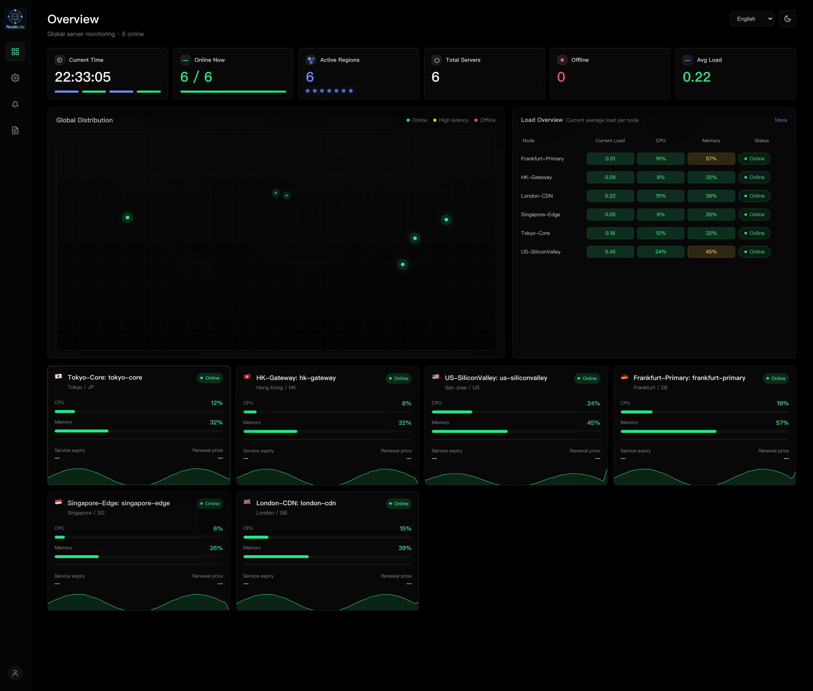

[简体中文](README.md) | [English](README.en.md)

[](https://github.com/XiNian-dada/NodeLite/actions/workflows/ci.yml)
[](https://codecov.io/gh/XiNian-dada/NodeLite)
[](LICENSE)

# NodeLite

NodeLite is a server monitoring dashboard written in Rust. Each monitored machine runs an agent that pushes metrics to the server over WebSocket; the server stores history, evaluates alerts, and serves an embedded web dashboard.

📖 **Documentation** (Chinese): <https://xinian-dada.github.io/NodeLite/>



## Features

- Live CPU, memory, disk, network, load and latency, with history stored in SQLite
- Server and agent are single static binaries; the web dashboard is embedded in the server. The agent runs on Linux and macOS
- Alerts via email (SMTP) and webhooks, with resolve notifications and a daily summary
- Monthly traffic quotas per node, with automatic bandwidth limiting through `tc` on Linux when the quota is exceeded
- Dashboard login with TOTP two-factor authentication and passkeys; agent tokens stored as Argon2id hashes; a separate security audit log
- Prometheus `/metrics` endpoint and a Grafana dashboard template
- Low resource use: about 10–15 MB for an idle server, about 2 MB per agent, about 514 MB for a server with 1,000 nodes ([benchmarks](docs/benchmarks.md))

## Quick start

Install the server on a Linux host with systemd:

```bash
curl -fsSL https://github.com/XiNian-dada/NodeLite/releases/latest/download/install-server.sh | sudo sh
```

The server listens on `127.0.0.1:8080`. In production, put it behind a reverse proxy with HTTPS. With Caddy that is:

```caddy
monitor.example.com {
    reverse_proxy 127.0.0.1:8080
}
```

With Nginx, forward WebSocket upgrades on `/ws` and keep the original `Host` header; see the [Nginx example](docs/reverse-proxy.md#nginx).

Issue an install command for each machine you want to monitor (it contains a one-time token valid for 15 minutes):

```bash
/usr/local/bin/nodelite-server --config /opt/nodelite/config/server.toml \
  install-agent --node-id hk-01 --node-label "Hong Kong 01"
```

Run the printed `curl ... | sh` command on the target machine. The node shows up in the dashboard within a few seconds.

Upgrade the server first, then the agents:

```bash
curl -fsSL https://github.com/XiNian-dada/NodeLite/releases/latest/download/install-server.sh | \
  sudo NODELITE_SERVER_MODE=upgrade sh
/usr/local/bin/nodelite-server --config /opt/nodelite/config/server.toml upgrade-agent
```

## Configuration

The server reads `/opt/nodelite/config/server.toml`. The annotated templates [`config/server.example.toml`](config/server.example.toml) and [`config/agent.example.toml`](config/agent.example.toml) document every option. A few worth knowing:

- `[server] public_base_url` must be an origin (scheme, host, optional port) without a path.
- `[server] trusted_proxies` lists your reverse proxy networks; without it all agents behind a remote proxy share one IP and hit rate limits.
- `[geoip]` is off by default. The `ipwhois` provider sends agent and visitor IPs to the third-party service ipwho.is; use `dbip` or `custom` for local lookups.
- `[metrics] allow_basic_scrape_with_2fa = true` lets Prometheus scrape `/metrics` with Basic Auth when 2FA is enabled.

## Building from source

```bash
cargo build --release -p nodelite-server -p nodelite-agent
cargo test --workspace
```

The frontend lives in `nodelite-server/web` (Vue 3 + Vite) and is bundled into the server binary at build time. See the [development guide](docs/development.md).

## Contributing

Issues and pull requests are welcome; see [CONTRIBUTING.md](CONTRIBUTING.md). Please report security issues privately as described in [SECURITY.md](SECURITY.md) rather than opening a public issue.

## License

[MIT](LICENSE)
