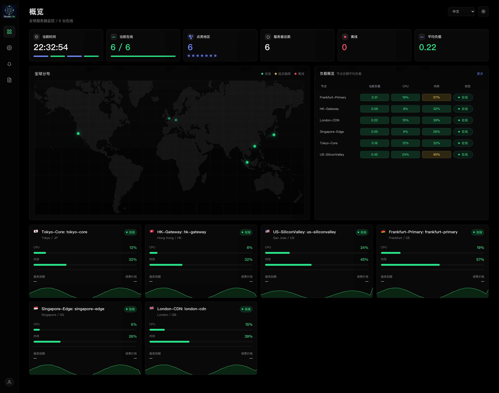

[简体中文](README.md) | [English](README.en.md)

[](https://github.com/XiNian-dada/NodeLite/actions/workflows/ci.yml)
[](https://codecov.io/gh/XiNian-dada/NodeLite)
[](LICENSE)

# NodeLite

NodeLite 是一个用 Rust 编写的服务器监控面板。每台被监控的机器运行一个 Agent，把指标通过 WebSocket 推送给 Server；Server 保存历史数据、评估告警，并提供内嵌的 Web 面板。

📖 **文档**：<https://xinian-dada.github.io/NodeLite/>



## 功能

- 实时查看 CPU、内存、磁盘、网络、负载和延迟，历史数据存储在 SQLite 中
- Server 和 Agent 都是单个静态二进制文件，Web 面板内嵌在 Server 中；Agent 支持 Linux 与 macOS
- 告警：邮件（SMTP）和 Webhook，支持恢复通知与每日巡检摘要
- 按月流量套餐统计用量，超额后在 Linux 上用 `tc` 自动限速
- 面板登录支持 TOTP 二次验证与 Passkey；节点 Token 以 Argon2id 哈希保存；独立的安全审计日志
- Prometheus `/metrics` 端点和 Grafana 仪表盘模板
- 资源占用低：空载 Server 约 10–15 MB，Agent 约 2 MB，1,000 个节点时 Server 约 514 MB（[性能基准](docs/benchmarks.md)）

## 快速开始

在一台 Linux（systemd）主机上安装 Server：

```bash
curl -fsSL https://github.com/XiNian-dada/NodeLite/releases/latest/download/install-server.sh | sudo sh
```

Server 默认监听 `127.0.0.1:8080`，生产环境请放在 Nginx 或 Caddy 后面并启用 HTTPS（[反向代理](docs/reverse-proxy.md)）。

为每台要监控的机器签发安装命令（含 15 分钟有效的一次性 Token）：

```bash
/usr/local/bin/nodelite-server --config /opt/nodelite/config/server.toml \
  install-agent --node-id hk-01 --node-label "Hong Kong 01"
```

把输出的 `curl ... | sh` 命令复制到目标机器执行，节点会在几秒内出现在面板上。完整步骤见[快速开始](docs/getting-started.md)。

## 文档

- [快速开始](docs/getting-started.md) · [反向代理](docs/reverse-proxy.md) · [配置](docs/configuration.md)
- [告警与巡检](docs/alerts.md) · [流量限速](docs/traffic-control.md) · [升级](docs/upgrades.md)
- [运维与排障](docs/operations.md) · [性能基准](docs/benchmarks.md) · [开发](docs/development.md)
- [安全模型](SECURITY.md) · [架构设计](DESIGN.md) · [更新日志](CHANGELOG.md)

## 从源码构建

```bash
cargo build --release -p nodelite-server -p nodelite-agent
cargo test --workspace
```

前端位于 `nodelite-server/web`（Vue 3 + Vite），构建 Server 时会自动打包并嵌入。详见[开发文档](docs/development.md)。

## 参与贡献

欢迎提交 Issue 和 Pull Request，流程与提交规范见 [CONTRIBUTING.md](CONTRIBUTING.md)。安全问题请按 [SECURITY.md](SECURITY.md) 私下报告，不要公开提交 Issue。

## 许可证

[MIT](LICENSE)
